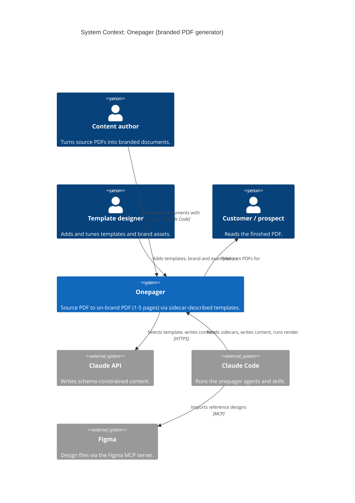

# Architecture: C4 diagrams

C4 model of the onepager system, kept in two formats with the same content:

| Level | Diagram | Mermaid | PlantUML | Rendered |
|---|---|---|---|---|
| 1. System context | Who uses Onepager and which outside systems it talks to | [mermaid](mermaid/01-system-context.mmd) | [plantuml](plantuml/01-system-context.puml) | [mermaid](rendered/01-system-context.mermaid.svg) · [plantuml](rendered/01-system-context.plantuml.svg) |
| 2. Container | The generator CLI, headless Chrome, Claude Code assets and the file stores | [mermaid](mermaid/02-container.mmd) | [plantuml](plantuml/02-container.puml) | [mermaid](rendered/02-container.mermaid.svg) · [plantuml](rendered/02-container.plantuml.svg) |
| 3a. Component | Inside the generator CLI (`src/`) | [mermaid](mermaid/03-component-generator.mmd) | [plantuml](plantuml/03-component-generator.puml) | [mermaid](rendered/03-component-generator.mermaid.svg) · [plantuml](rendered/03-component-generator.plantuml.svg) |
| 3b. Component | Claude Code agents, skills and settings (`.claude/`, `CLAUDE.md`) | [mermaid](mermaid/04-component-claude-code.mmd) | [plantuml](plantuml/04-component-claude-code.puml) | [mermaid](rendered/04-component-claude-code.mermaid.svg) · [plantuml](rendered/04-component-claude-code.plantuml.svg) |
| Dynamic | `npm run generate`: write, render, fit, revise | [mermaid](mermaid/05-dynamic-generate.mmd) | [plantuml](plantuml/05-dynamic-generate.puml) | [mermaid](rendered/05-dynamic-generate.mermaid.svg) · [plantuml](rendered/05-dynamic-generate.plantuml.svg) |

The PlantUML versions carry the fuller descriptions and lay out more cleanly. The Mermaid versions use shorter labels, because Mermaid's C4 support is experimental and wraps wide boxes into a single column. They render natively on GitHub and in most Markdown viewers.

## Key ideas the diagrams show

- **Two ways to run, one engine.** The standalone CLI calls the Claude API itself (`OnePagerAgent`). Inside Claude Code, the `onepager-designer` agent writes the `.content.json` and only uses the CLI to validate and render. Both share the same templates, renderer and fit check.
- **Sidecars are the contract.** `template.json`, `brand.json` and `example.json` describe each asset to the code and to the agent. The `.content.json` output sidecar makes every PDF reproducible without calling the API.
- **Fit loop.** The renderer measures each page with `.fit-measure` set on `<html>`, so templates' space-spreading rules are switched off and free space is honest. `describeFit()` turns the result into feedback for the agent ("page 2 overflows by ~8%").
- **Figma as a reference source.** When `examples/` is empty, the `import-figma-example` skill pulls page renders and design tokens through the Figma MCP server.

## Context (Mermaid, rendered inline on GitHub)



## Regenerating the rendered SVGs

```bash
# Mermaid (needs @mermaid-js/mermaid-cli: npm i -g @mermaid-js/mermaid-cli)
for f in docs/c4/mermaid/*.mmd; do mmdc -i "$f" -o "docs/c4/rendered/$(basename "$f" .mmd).mermaid.svg"; done

# PlantUML (needs Java and plantuml.jar; the C4 library is bundled, no network include)
java -jar plantuml.jar -tsvg -o ../rendered docs/c4/plantuml/*.puml
# then rename docs/c4/rendered/NN-name.svg to NN-name.plantuml.svg
```

When the code changes (a new template capability, a new agent or skill, a new external system), update both formats and re-render.
